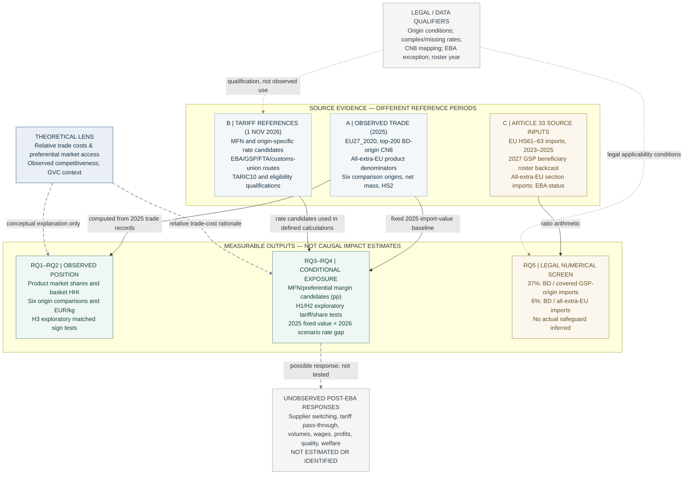

# CHAPTER 3: THEORETICAL FRAMEWORK

## 3.3 Conceptual Framework Diagram

The conceptual framework translates the theoretical propositions developed in Section 3.1 and the operational definitions established in Section 3.2 into a visual representation of the research design. Its central purpose is to distinguish **observed market participation**, **legally conditional tariff differences**, and **unobserved responses to a future change in market access**. This distinction is essential because a theory of relative international trade costs establishes why origin-specific tariffs may be economically relevant but does not, without an appropriate identification strategy, demonstrate the causal effect of such tariffs on observed or future trade flows (Anderson & van Wincoop, 2003; Cipollina et al., 2017). Figure 3.1 therefore presents the measurement pathways associated with the study's five research questions, while identifying institutional conditions and theoretical mechanisms that remain outside its direct empirical reach.

**Figure 3.1. Conceptual framework for Bangladesh's prospective EU market-access exposure: source evidence, measurement pathways, and inferential boundaries**

*Note.* **Solid arrows** connect source evidence to a directly calculated descriptive measure, exploratory contrast, or fixed-value accounting result; they do **not** indicate identified causal relationships. **Dotted arrows** indicate either legal or measurement qualifications, or explicitly labelled theoretical relationships that are not directly tested; the text on each arrow states its function. In the accompanying high-resolution figure, theoretical arrows are differentiated as **dashed**, while legal/measurement conditions remain dotted. An arrow from a tariff candidate or static exposure measure toward an unobserved response represents a plausible conceptual mechanism only and is **not** an empirical estimate. BD = Bangladesh; CN8 = eight-digit Combined Nomenclature; EBA = Everything But Arms; EU = European Union; GSP = Generalised Scheme of Preferences; HHI = Herfindahl–Hirschman index; HS2 = two-digit Harmonized System chapter; MFN = most-favoured-nation; pp = percentage points. *Source:* Author's analytical synthesis of the theoretical and measurement arguments in Anderson and van Wincoop (2003), Cipollina et al. (2017), French (2017), Sytsma (2021, 2022), and Gervais (2015), with trade variables defined from Eurostat (2025) and legal conditions from Regulation (EU) 2026/1395 (European Parliament & Council of the European Union, 2026). The figure is not adapted or reproduced from a pre-existing published diagram.

### 3.3.1 Theoretical Foundations and Distinct Evidence Streams

At the conceptual level, the framework is guided by **relative trade costs and preferential market access**. Structural gravity theory emphasizes the relevance of trade frictions in relation to alternative sources of supply, supporting a comparison of Bangladesh's tariff and market position with those of other countries supplying the same EU products (Anderson & van Wincoop, 2003). Research on EU preferential policies further indicates that the definition of a tariff preference margin and its sector-specific context affect its interpretation (Cipollina et al., 2017). These propositions justify the selection of relative supplier comparisons; they do not turn a 2025 EU trade observation and a 2026 tariff rate into a causal before-and-after design.

The figure consequently begins with three **separate source streams**. Stream A contains observed **2025** EU import records for Bangladesh's leading 200 CN8 products, the official extra-EU product-market totals, observations for China, India, Viet Nam, Pakistan, Cambodia, and Türkiye, and valid quantities and sector codes. Stream B contains EU **1 November 2026** MFN and origin-specific preferential tariff candidates together with their tariff-line and legal-condition flags. Stream C contains annual **2023–2025** EU imports of the products represented in HS Chapters 61–63 and the explicitly dated beneficiary-country roster and legal definitions needed for the Article 33 screening exercise. Streams A and B differ in time and statistical nature, while Stream C has a separate chapter-level and country-grouped denominator structure. The diagram does not pool these distinct records into a single longitudinal product-level treatment panel.

### 3.3.2 Observed Competitiveness Indicators: RQ1 and RQ2

The first measured pathway leads from the 2025 trade records to the descriptive indicators associated with **RQ1 and RQ2**. Bangladesh's product-specific share is calculated using its EU import value divided by the corresponding **published extra-EU import value from all origins**, rather than by the sum for the six named comparator countries. Product-basket concentration is calculated using value weights within the selected 200-line cohort. Competitor positioning is examined through matched import values and product shares, together with EUR-per-kilogram customs unit values where reliable quantities exist. These transformations are arithmetic descriptions of recorded trade and therefore are represented by **solid measurement arrows**.

The indicators are interpreted using research on the limitations of trade-based competitiveness measures. French (2017) demonstrates that revealed comparative advantage indices depend on their theoretical interpretation and the trade-cost setting, while Gervais (2015) explains why unit values do not uniquely identify product quality or firm productivity. The corresponding diagram therefore uses the expression **observed market position**, rather than treating market shares or unit-value ratios as a complete measure of comparative advantage, production efficiency, or exporters' future resilience. The H3 matched-sign comparisons belong to this descriptive strand as exploratory tests; they do not establish that Bangladesh produces goods of identical quality at a lower cost.

### 3.3.3 Tariff-Rate Conditions, Exploratory Associations, and Static Exposure: RQ3 and RQ4

The second measured pathway connects the **2026 tariff reference** and the **2025 fixed-value baseline** to the constructs required for **RQ3 and RQ4**. Product-level MFN and conditional origin-specific rates are used to construct nominal preference margins and comparator-relative tariff differences, subject to each product's qualification status. The influence of origin conditions is explicitly marked because rules-of-origin requirements can affect whether a legally offered preference is actually claimed (Sytsma, 2021, 2022). Published tariff candidates are therefore not represented as realised customs duties paid on the observed imports.

This strand also includes the exploratory analyses defined in Chapter 1. **H1** compares 2026 MFN rate candidates across the selected HS61–63 lines and other selected products; **H2** examines the rank association between 2025 Bangladesh EU product-market shares and 2026 MFN candidates, including sector-sensitive interpretation. These are associations and descriptive comparisons involving the selected cohort, not tests of the effect of future EBA withdrawal. A tariff schedule may differ systematically across sectors, while 2025 market shares reflect many other commercial and structural factors. Therefore, no arrow is drawn from the 2026 policy benchmark to the earlier market-share outcome as though a causal impact had been identified.

For **RQ4**, the framework specifies a **deterministic accounting route**. The observed 2025 import value for each qualified product is held fixed and multiplied by a specified difference between scenario and baseline tariff rates. Aggregating these product contributions produces a static tariff-duty equivalent in euros. The construct measures the arithmetic scale of exposure *under the defined rate assumptions* and necessarily depends on the included products and valid legal tariff comparisons. It does not identify tariff incidence, changes in import demand, actual future customs liability, or Bangladesh's lost export earnings. Those behavioural questions are studied through additional assumptions or empirical designs in the wider literature, including general-equilibrium and partial-equilibrium modelling (Rahman & Strutt, 2024; Bekkers & Cariola, 2025).

### 3.3.4 Historical Safeguard Screening: RQ5

The third pathway is deliberately separated from the 2025 top-200 CN8 tariff basket. **RQ5** concerns the numerical application of legal definitions to historic **2023–2025** EU import observations for the textile and apparel section represented by HS Chapters 61–63. The Article 33 framework distinguishes a **37% share of relevant imports from GSP beneficiary origins** from the separate **6% exception based on all relevant Union imports**. Thus, the two ratios have different denominators and cannot be replaced by Bangladesh's global export share or by the trade values of the six selected competitors (European Parliament & Council of the European Union, 2026, art. 33 and Annex IV).

The diagram also indicates that historical calculations applying the **2027 Annex I beneficiary roster** to earlier import observations are *backcasts*, not evidence of the beneficiary group legally operative in each historical year. In addition, the Article 33 mechanism does not apply to Bangladesh while it remains an EBA beneficiary, and satisfying a numerical condition would not itself constitute an implemented safeguard. The relevant legal status, procedures, and implementing acts must therefore be evaluated separately from the arithmetic. The output of RQ5 is a **legally qualified numerical screen**, not a prediction that additional duties will be imposed.

### 3.3.5 Untested Mechanisms and Interpretation of the Framework

The lower portion of Figure 3.1 identifies the **boundary between the study's measured constructs and plausible but unobserved economic outcomes**. Trade-cost theory suggests that tariff changes may influence sourcing incentives; GVC and heterogeneous-firm research provides reasons why responses may differ across firms and supply networks (Gereffi et al., 2005; Melitz, 2003). Such theoretical relationships are relevant to the eventual interpretation of Bangladesh's market-access risks but cannot be estimated from the product–origin records available to this thesis. The dataset does not contain observed post-EBA export volumes, firm contracts, domestic value-added measures, buyers' tariff pass-through arrangements, or employment responses. Arrows indicating these possible responses are therefore labelled **theory only—not tested** and are excluded from the study's computed empirical outputs.

The framework additionally treats missing tariff rates, complex or non-ad valorem duty types, classification uncertainty, invalid mass comparisons, and selected-sample coverage as **measurement constraints**, rather than variables to be replaced with unsupported assumptions. Consistent product definition is particularly relevant to any historical comparison because CN8 classifications can change from year to year (Baumgartner et al., 2023). The principal 2025 cross-section and the historical HS2 safeguard series are therefore kept distinct; an unauthenticated 2012–2025 CN8 growth panel is not represented.

Overall, Figure 3.1 presents two linked forms of analysis—**observed EU market position** and **conditional prospective tariff exposure**—alongside a **separate legal safeguard screen**. The links among data sources, constructed measures, and research questions are explicit, but the theoretical possibility that tariffs influence actual trade behaviour is not confused with an effect estimated by the present research. This distinction preserves the alignment of Sections 3.1–3.3 with the five research objectives and provides the conceptual basis for the source and formula procedures to be specified in Chapter 4.

---

## References Cited in Section 3.3 (APA 7th Edition)

Anderson, J. E., & van Wincoop, E. (2003). Gravity with gravitas: A solution to the border puzzle. *American Economic Review, 93*(1), 170–192. https://doi.org/10.1257/000282803321455214

Baumgartner, C., Srhoj, S., & Walde, J. (2023). Harmonization of product classifications: A consistent time series of economic trade activities. *Jahrbücher für Nationalökonomie und Statistik, 243*(6), 643–662. https://doi.org/10.1515/jbnst-2022-0034

Bekkers, E., & Cariola, G. (2025). The impact of LDC graduation on trade: A quantitative assessment. *The Journal of International Trade & Economic Development, 34*(3), 397–427. https://doi.org/10.1080/09638199.2024.2323661

Cipollina, M., Laborde Debucquet, D., & Salvatici, L. (2017). The tide that does not raise all boats: An assessment of EU preferential trade policies. *Review of World Economics, 153*(1), 199–231. https://doi.org/10.1007/s10290-016-0270-0

European Parliament, & Council of the European Union. (2026). *Regulation (EU) 2026/1395 of 17 June 2026 on applying a generalised scheme of tariff preferences and repealing Regulation (EU) No 978/2012*. *Official Journal of the European Union*. https://eur-lex.europa.eu/eli/reg/2026/1395/oj/eng

Eurostat. (2025). *International trade in goods—Detailed data (ext_go_detail): Reference metadata*. European Commission. https://ec.europa.eu/eurostat/cache/metadata/en/ext_go_detail_sims.htm

French, S. (2017). Revealed comparative advantage: What is it good for? *Journal of International Economics, 106*, 83–103. https://doi.org/10.1016/j.jinteco.2017.02.002

Gereffi, G., Humphrey, J., & Sturgeon, T. (2005). The governance of global value chains. *Review of International Political Economy, 12*(1), 78–104. https://doi.org/10.1080/09692290500049805

Gervais, A. (2015). Product quality and firm heterogeneity in international trade. *Canadian Journal of Economics/Revue canadienne d'économique, 48*(3), 1152–1174. https://doi.org/10.1111/caje.12171

Melitz, M. J. (2003). The impact of trade on intra-industry reallocations and aggregate industry productivity. *Econometrica, 71*(6), 1695–1725. https://doi.org/10.1111/1468-0262.00467

Rahman, M. M., & Strutt, A. (2024). Costs of LDC graduation on market access: Evidence from emerging Bangladesh. *Economic Systems Research, 36*(1), 24–45. https://doi.org/10.1080/09535314.2022.2138271

Sytsma, T. (2021). Rules of origin and trade preference utilization among least developed countries. *Contemporary Economic Policy, 39*(4), 701–718. https://doi.org/10.1111/coep.12529

Sytsma, T. (2022). Improving preferential market access through rules of origin: Firm-level evidence from Bangladesh. *American Economic Journal: Economic Policy, 14*(1), 440–472. https://doi.org/10.1257/pol.20200257
