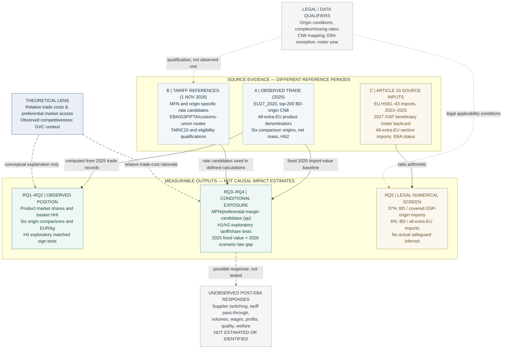

# CHAPTER 3: THEORETICAL FRAMEWORK

## 3.1 Explanation of Selected Theory

This study examines Bangladesh’s prospective market-access exposure in the European Union (EU) following its eventual transition from least developed country (LDC)-based trade preferences. The unit of substantive interest is not the individual exporting firm or an investment-location decision, but the relationship between **product-specific trade conditions, observed EU import-market positions, and conditional tariff-preference exposure**. The theoretical framework must therefore explain why origin-specific tariffs are relevant to international competition while remaining consistent with the study's observational design and its inability to observe a realised post-EBA trade adjustment. On these grounds, the study adopts a **relative trade-cost and preferential-market-access framework**, grounded in structural gravity reasoning, as its primary analytical perspective. The comparative-advantage literature informs the interpretation of measured export-market positions, whereas rules-of-origin research and global value chain (GVC) governance provide qualifying institutional and organizational insights. These perspectives have different roles and are not presented as a collection of independently estimated causal models.

### 3.1.1 Relative Trade Costs and Structural Gravity as the Primary Theoretical Foundation

International trade theory recognizes that participation in a foreign market is shaped not only by production capabilities and destination demand but also by the costs of trading across borders. Such costs include transport and administrative requirements, information and contractual frictions, and tariffs imposed at importation. In a structural gravity framework, the economic significance of a bilateral trade barrier depends on conditions in alternative trading relationships. Anderson and van Wincoop (2003) formalize this principle through **multilateral resistance**, showing why trade flows cannot be understood solely through the absolute cost separating one exporter and one importer.

This relational perspective is particularly important for interpreting Bangladesh's EU market access. Bangladesh-origin goods compete with imports from other countries, and the relevant tariff environment may differ across origins and product lines. A preferential duty can confer a considerable *nominal* advantage relative to one supplier while creating little difference relative to another that receives similar treatment. Equally, a product subject to a zero most-favoured-nation (MFN) duty does not acquire a positive MFN-based margin merely because it enters through a preferential arrangement. The conceptual relevance of a preferential tariff therefore depends on the **counterfactual reference duty and the conditions facing alternative suppliers**, not only on Bangladesh's own statutory rate (Brenton, 2003; Cipollina et al., 2017).

The structural gravity perspective supplies a theoretical rationale for examining **matched destination–product markets and comparator origins**. It does not, however, imply that the present thesis estimates a structural gravity equation. Such estimation requires data and identifying variation appropriate to the trade-flow model and its multilateral resistance terms. The available core evidence comprises selected Bangladesh-origin EU imports in **2025** and tariff candidates referenced to **1 November 2026**; Bangladesh's future EBA withdrawal has not occurred in these observations. Consequently, the analysis cannot estimate a structural tariff elasticity, a treatment effect, or changes in trade flows caused by a future tariff event. Structural gravity is retained as the *conceptual foundation for relative trade-cost comparisons*, rather than a claim about the empirical estimator employed.

### 3.1.2 Preferential Market Access, Preference Erosion, and Trade Diversion

Preferential market access can be understood as an institutional modification of the trade-cost conditions faced by specified exporting origins. A **nominal MFN-based preference margin** compares the reference MFN rate for a given good with the preferential rate available to an eligible origin. A **competitor-relative tariff advantage** instead compares the potentially applicable rates for Bangladesh and another exporting origin in the same product market. The two measures answer different questions: the first describes an advantage relative to the general tariff, while the second describes a difference between selected suppliers. Brenton (2003) demonstrates the importance of MFN baselines for the additional value of EU preferences, while Cipollina et al. (2017) show, using detailed EU trade observations, that estimated preferential-trade effects are sensitive to the definition of the margin and heterogeneous across sectors.

Tariff preference erosion consequently has more than one possible source. It may result from a reduction or withdrawal of Bangladesh's preferential treatment, a decrease in the general MFN tariff, or improved preferential access for competing exporting countries. These events are not economically identical. For example, a narrowing of a preference margin caused by lower MFN rates need not imply that the beneficiary's own duty has increased. Moreover, the literature on selective preferential access indicates that trade may be reallocated among suppliers, making relative rather than solely bilateral tariff conditions important for analysis (Borchert, 2009). This provides a reason to consider a defined set of competing origins rather than interpreting Bangladesh's prospective EBA exit as a uniform tariff shock experienced in isolation.

Yet **statutory eligibility and effective access must be distinguished**. An otherwise preferential rate may depend on product classification, rules of origin, documentary conditions, and the relevant trade scheme. Evidence from the EU's 2011 apparel rules-of-origin reform shows that such conditions materially affect preference utilisation, and Bangladesh-specific firm data demonstrate that exporters can adjust their sourcing and shipments when origin requirements change (Sytsma, 2021, 2022). Thus, a published duty reduction should be understood as an available legal opportunity conditional on compliance, not proof of an advantage claimed on every observed import transaction. This also limits the meaning of a comparison with the tariff candidate of a competitor whose preferential qualification has not been verified.

Finally, a **loss of preference margin** is not equivalent to a **loss of export revenue**. Tariff incidence depends on the conduct of suppliers, importers, and consumers; import demand and sourcing responses require additional behavioural information. Empirical trade models can investigate such responses under defined assumptions, as illustrated by the computable general-equilibrium assessment of Rahman and Strutt (2024) and the preference-utilisation-adjusted partial-equilibrium study of Bekkers and Cariola (2025). The present thesis instead assesses source-dated tariff differentials and their fixed-import-value accounting equivalents. Its measures indicate the *scale and distribution of conditional statutory exposure*, not changes in export volumes, employment, profitability, or welfare.

### 3.1.3 Institutional Eligibility and Rules of Origin as Conditioning Mechanisms

The economic interpretation of preferences must be situated within the relevant legal architecture. The EU distinguishes EBA, Standard GSP, and GSP+ arrangements, each with its own beneficiary and product conditions. Accordingly, institutional eligibility operates as a **conditioning mechanism**: it determines whether the preferential tariff considered in the economic analysis is legally available for a specified origin and product. The EU's revised regulatory framework also contains a transition mechanism for removing countries from EBA following the loss of LDC status (European Parliament & Council of the European Union, 2026, art. 17).

This institutional context has become particularly important for Bangladesh. The United Nations General Assembly (2026) extended its preparatory period for LDC graduation until **24 November 2029**. The revised EU regulation provides a separate three-year transition mechanism before eventual removal from EBA. An indicative EBA exit around **November 2032** is therefore a *conditional horizon*, not an already established product-specific tariff-effective date. Nor does it establish that Bangladesh will receive Standard GSP, GSP+, or MFN treatment after the transition. Whether a preference can be claimed also depends on product-specific origin and documentary requirements, which the reviewed literature identifies as economically significant (Sytsma, 2021, 2022).

The institutional framework is thus indispensable to the study, but this does not make **institutional theory** an independently estimated explanatory model. The research does not observe cross-country changes in institutional quality, regulatory enforcement, or organizational legitimacy as explanatory variables. It documents legal statuses, eligibility conditions, and conditional policy alternatives. The same distinction applies to the EU's special textile safeguards: relevant numerical thresholds and exemptions are **legal decision rules**, not theoretical estimates of an exporter response. Their operation must be evaluated with the legally specified origin groups, denominators, beneficiary status, and implementation procedures (European Parliament & Council of the European Union, 2026, art. 33 and Annex IV). An arithmetic threshold screen is therefore analytically distinct from both a causal hypothesis and an enforceable tariff decision.

### 3.1.4 Comparative Advantage and Observed Export Competitiveness

The comparative-advantage literature offers a complementary basis for interpreting the distribution of exports across products. Balassa (1965) developed a revealed comparative advantage indicator using relative export specialization, making observed trade patterns an empirical basis for studying international specialization. However, the meaning of a trade-based indicator depends on its definition and reference group. French (2017) shows that different revealed comparative advantage measures answer different questions and can be affected by trade costs. Accordingly, no single trade-share statistic can be treated as a context-free measure of underlying productivity.

The present thesis examines **Bangladesh's share of EU extra-EU imports in a particular CN8 product market**. Such a share describes Bangladesh's *observed destination-specific market position*. It is not the conventional Balassa RCA index, because its denominator is imports into one destination rather than a consistent world-export specialization benchmark. Neither can the share establish the reason for an observed competitive position: tariff conditions, relative supplier capabilities, consumer preferences, product characteristics, and established sourcing networks may all influence the outcome. For this reason, the term **export competitiveness** is operationalized cautiously as the observable distribution of EU product-market participation and associated descriptive measures, rather than as a comprehensive measure of firm productivity or national comparative advantage.

Two related indicators require similar care. Product-value concentration describes how trade is distributed within the product set being assessed; when calculated for a purposively selected top-200 cohort, it describes that cohort rather than an unrestricted national product universe. Customs unit values, calculated as import value per valid unit of reported net mass, permit matched product–origin comparisons but do not uniquely identify underlying quality, costs, or prices received by exporters. Gervais (2015) establishes the importance of separating quality from other aspects of firm and price heterogeneity. Consequently, the present analysis can describe unit-value differences without inferring that one supplier necessarily has greater productive efficiency or produces goods of equal quality. These measurement distinctions keep the theoretical discussion aligned with the quantities actually recorded in EU trade statistics.

### 3.1.5 Global Value Chain Governance and Firm Heterogeneity: Context Rather Than Direct Tests

A trade-cost framework explains the relevance of differences in market-access conditions, but it does not fully describe how individual exporters might react to those conditions. GVC governance theory provides a complementary understanding of cross-border production relationships. Gereffi et al. (2005) identify market, modular, relational, captive, and hierarchical governance forms whose differences arise in part from transaction complexity, information codification, and supplier capabilities. Such organizational conditions may influence how producers meet sourcing requirements, negotiate with lead firms, or adjust to changes in trade rules.

This perspective is substantively relevant to Bangladesh because preferences and origin rules interact with the organization of textile and garment value chains. Curran and Nadvi (2015) examine how changing preferential arrangements relate to sourcing and production structures within Bangladesh's knitwear and woven-garment industries. In a related but distinct theoretical approach, Melitz (2003) demonstrates why heterogeneous firms may participate in export markets and respond to trade-cost changes differently. Together, these contributions suggest plausible channels through which a common policy change could have unequal effects across firms and products.

Neither theory is directly tested by the present dataset. EU product–origin import records do not reveal the exporting firm, its productivity, buyer contracts, domestic value addition, or the division of tariff costs across the value chain. The study therefore cannot estimate GVC governance categories, firm-selection effects, or tariff pass-through using these observations. These perspectives remain **contextual explanations for possible future adjustment**, not empirically established mediators of the associations measured in this thesis.

### 3.1.6 Final Theoretical Selection and Inferential Boundaries

The above considerations support a coherent division of theoretical roles. **Relative trade-cost theory and structural gravity reasoning** provide the primary justification for considering tariff conditions in relation to competing sources of supply (Anderson & van Wincoop, 2003). **Preference-margin and trade-diversion scholarship** explains why product and origin differences matter, and why legal eligibility, origin rules, and actual use must be distinguished (Brenton, 2003; Borchert, 2009; Cipollina et al., 2017; Sytsma, 2021). **Comparative-advantage and competitiveness scholarship** clarifies what can—and cannot—be inferred from destination-market shares, concentration, and unit values (Balassa, 1965; French, 2017; Gervais, 2015). Finally, **GVC governance and heterogeneous-firm theory** provide interpretive context without becoming claims of tested firm-level mechanisms (Gereffi et al., 2005; Melitz, 2003).

The framework deliberately excludes the ownership–location–internalisation (OLI) paradigm as a principal explanatory theory. Dunning (1988) developed OLI to explain international production and multinational enterprise activity through ownership, location, and internalisation advantages. Because the current research does not measure foreign direct investment, multinational ownership, or international production-location decisions, OLI does not directly correspond to its explanatory constructs or data. Similarly, the research does not require an independent theory of institutional change merely because its tariff scenarios are conditioned on EU legal rules.

Three forms of claim must remain separate throughout the subsequent chapters. The first is a **theoretical proposition**: relative tariff conditions and preferences can influence the incentives governing international sourcing and trade. The second is an **empirical description**: the study records 2025 EU import values, product market shares, selected competitor observations, and reference-date tariff candidates. The third is a **conditional accounting statement**: specified tariff-rate differences can be applied to unchanged baseline trade values to compute static duty equivalents, provided that rate and product coverage are qualified. Only the second and third are directly implemented with the study's current administrative trade and tariff data. No causal relationship among these three levels is identified merely because a conceptual arrow is drawn between them.

The theoretical framework thus explains *why* market-access differences are relevant, *which* observable indicators can reasonably describe Bangladesh's existing EU position, and *where* the evidence ends. The subsequent section operationalizes these distinctions as a variable and measurement framework; the conceptual diagram then separates documented measures, scenario arithmetic, and potential but unobserved adjustment mechanisms.

## 3.2 Application of Theory to Research Variables

The theoretical perspectives established in Section 3.1 are applied in this study through a set of **observed trade indicators, source-dated tariff benchmarks, constructed accounting measures, and legally specified numerical screens**. This operationalization follows the distinction between relative trade-cost incentives and realised market outcomes. Structural gravity reasoning provides a theoretical explanation for the relevance of competing suppliers and relative market-access conditions (Anderson & van Wincoop, 2003), while the empirical literature on EU preferential treatment demonstrates why tariff margins must be defined at the relevant product and origin level (Cipollina et al., 2017). Neither perspective, however, implies that a relationship observed between differently dated trade and tariff variables establishes the causal effects of preferential treatment. The framework therefore assigns each construct a specific analytical role, reference period, measurement unit, and limitation rather than dividing all variables mechanically into independent and dependent categories.

### 3.2.1 Empirical Scope, Units of Observation, and Variable Classification

The primary trade population for the analysis consists of merchandise imports reported by the **EU-27 aggregate (EU27_2020)** from non-EU origins, using Eurostat's **Comext dataset DS-045409**. The principal reference year is **2025**, and Bangladesh is defined as the **country of origin** for the corresponding EU import observations. Eurostat's detailed trade statistics record customs values and quantities by origin and product; these are import-side observations and should not be treated without qualification as Bangladesh-reported free-on-board export declarations (Eurostat, 2025). The main product sample comprises the **200 Combined Nomenclature eight-digit (CN8) lines with the largest recorded Bangladesh-origin EU import values in 2025**. This is a purposive value-based cohort, not a random selection of products or the complete Bangladesh export universe.

Three distinct observational grains are required. The **CN8 product** is the unit for Bangladesh-origin market positions, basket weights, product classification, and most tariff-based comparisons. The **CN8 product × supplying origin** is the unit for comparison with China, India, Viet Nam, Pakistan, Cambodia, and Türkiye, allowing matched import values, product-market shares, and valid customs unit values to be examined. For the EU safeguard analysis, the unit changes to **calendar year × relevant Harmonized System (HS) chapter or GSP section × origin grouping**, rather than the 2025 CN8 cohort. A further distinction applies to tariff information: the EU tariff data constitute **product- and origin-specific reference-date legal candidates as of 1 November 2026**, not observed duties paid on the 2025 shipments.

For interpretation, the constructs are classified as follows. **Observed variables** are recorded EU trade values and quantities for the stated periods. **Descriptive indicators** are reproducible transformations of those observations, such as market shares and unit values. **Tariff-policy benchmarks** are legally qualified or conditionally available rates taken from source-dated tariff measures. **Scenario-derived variables** are counterfactual arithmetic based on fixed observed values and assumed alternative rates. **Legal screening indicators** are ratios or eligibility statuses defined by EU law. Finally, **exploratory statistical contrasts** describe relationships within the selected data; they do not represent an identified post-graduation treatment effect. This classification follows the literature's distinction between revealed trade positions, preferential eligibility, and behavioural economic consequences (French, 2017; Sytsma, 2021; Bekkers & Cariola, 2025).

### 3.2.2 Objective 1: Observed Product-Market Position and Export Concentration

The first objective concerns the product composition of Bangladesh-origin EU imports and Bangladesh's position within individual EU import markets. Let **p** denote a selected 2025 CN8 product and **c** denote an extra-EU supplying origin. The observed import-value variable, **V(c,p,2025)**, is the EU-recorded customs value in euros for the stated product and origin. The corresponding **V(EU-extra,p,2025)** is the published all-extra-EU-origin import total for the same product and year. Bangladesh's product-market share is defined as:

**MS(BD,p,2025) = 100 × V(BD,p,2025) / V(EU-extra,p,2025).**

The denominator is the *official all-extra-EU import value*, **not** the sum of the six selected competitor values and **not** the total value of imports from GSP beneficiaries. If the official product-market denominator is missing, invalid, or zero, the share is classified as unavailable rather than set equal to zero. This variable is a destination-specific measure of observed market position. Although it relates to the broader comparative-advantage literature, it is **not equivalent to the conventional Balassa revealed comparative advantage index**, which uses a different set of export benchmarks (Balassa, 1965; French, 2017).

A separate measurement addresses product concentration within the selected Bangladesh-origin basket. For each included product, its **basket weight** is the product's Bangladesh-origin import value divided by the sum of Bangladesh-origin values across the 200 selected products. A **conditional product Herfindahl–Hirschman index (HHI)** is then the sum of squared basket weights; it may be reported on a 0–1 or, after multiplying by 10,000, a 0–10,000 scale. This index describes concentration **within the selected 200 products**. It must not be presented as a concentration estimate for all Bangladeshi exports to the EU unless the full Bangladesh-origin product universe is separately incorporated. Sectoral composition is described by grouping the selected CN8 lines into their observed 2025 HS two-digit (HS2) chapters.

The theoretical justification for these variables is limited but important. Comparative-advantage analysis regards observed trade patterns as informative about specialization, while also recognizing that such patterns reflect trade costs and demand conditions, not solely productive efficiency (Balassa, 1965; French, 2017). The present study therefore treats **V**, **MS**, and product-basket **HHI** as *descriptive outcomes and distributional measures*. It does not infer a causal relationship between the tariff benchmarks and Bangladesh's 2025 trade position.

### 3.2.3 Objective 2: Competitor-Origin Positioning and Customs Unit Values

The second objective applies the relative trade-cost perspective to a common set of destination-product markets. For each selected CN8 product **p** and comparator **c**, the study observes the **EU import value from that origin**, denoted **V(c,p,2025)**, and defines its **EU product-market share** using the same official all-extra-EU-origin product denominator used for Bangladesh. Matching comparator observations to a common 2025 CN8 code avoids comparing different product categories, while the shared destination-market denominator preserves the relative scale of all supplying countries. The six competitors form a substantively chosen reference group; their aggregate values do not exhaust the EU's supplier universe.

The analysis also examines customs unit values where import values and positive, comparable net-mass quantities are recorded. Let **Q(c,p,2025)** denote net mass in kilograms. The unit value is:

**UV(c,p,2025) = V(c,p,2025) / Q(c,p,2025)**, expressed as **EUR/kg**.

A matched Bangladesh-to-competitor ratio, **R(BD,c,p,2025)**, divides Bangladesh's unit value by that of origin **c** for the *same CN8 code and reference year*. A value below one means only that the recorded EU customs value per kilogram is lower for Bangladesh than for the comparison origin. It does not establish lower production costs, higher productivity, identical product quality, or the price actually received by the exporting firm. Gervais (2015) illustrates why quality identification requires more than direct unit-value comparisons, while the evidence on exporter heterogeneity and product differentiation provides reasons to expect within-product variation (Melitz, 2003; Hummels & Klenow, 2005).

An origin-product comparison is included only where relevant data are reported and the net-mass denominator is valid. An absent trade or quantity record is **not** automatically treated as zero. The currently verified matched comparison file contains 1,200 candidate Bangladesh–competitor product pairs and 1,186 valid unit-value ratios; the remaining observations must retain their source-defined exclusion status. If concentration among suppliers to a product market is also presented, it must account for the difference between recorded country-origin totals and the published all-extra-EU aggregate. A supplier HHI calculated from an incomplete set of origins is a **provisional or bounded measure**, not an exact full-market concentration estimate. These safeguards keep comparisons descriptively meaningful without implying that supplier competition is fully explained by a unit-value ratio.

### 3.2.4 Objective 3: Tariff-Policy Benchmarks, Relative Advantages, and Sectoral Heterogeneity

The third objective operationalizes the central trade-cost mechanism. For selected product **p**, **tMFN(p,2026-11-01)** denotes a numerically qualified EU MFN ad valorem duty candidate at the **1 November 2026** reference date. For supplying origin **c**, **tPref(c,p,2026-11-01)** denotes an origin- and product-specific preferential-rate candidate *where an applicable and comparable numerical measure can be established*. A recorded origin-specific rate is classified by its legal pathway, qualification status, and source date. In particular, an origin may appear within a GSP, free-trade agreement, or customs-union pathway without every shipment automatically satisfying the conditions for the associated duty. The distinction between nominal eligibility and claimed preference is supported by evidence from the EU rules-of-origin literature (Sytsma, 2021, 2022).

Two rate differences are conceptually relevant. The **MFN-reference nominal preference margin for Bangladesh** is **tMFN(p) − tPref(BD,p)**, conditional on the Bangladesh preference and the relevant product being eligible. The **competitor-relative candidate tariff advantage for Bangladesh against origin c** is **tCandidate(c,p) − tCandidate(BD,p)**. Positive values indicate that the reference tariff candidate for the comparator is higher than the Bangladesh candidate; a zero difference indicates no nominal rate difference *under the specified legal assumptions*. Both measures are expressed in **percentage points**, not percent changes. These distinctions reflect preferential-trade research showing that estimated advantages differ with the choice of reference tariff and competitive setting (Borchert, 2009; Cipollina et al., 2017).

The empirical tariff matrix is reconstructed from official EU tariff information with measures and conditions referenced to November 2026. The nominal rate is not necessarily the **effective, transaction-level duty** because proof of origin, eligibility, additional customs conditions, particular tariff lines, and actual preferential claims have not been universally verified. For example, customs-union circulation conditions for Türkiye must not be confused with ordinary preferential-origin status. Nor can a 2026 Standard GSP or GSP+ channel assigned to another origin be treated as an established future Bangladeshi rate. If a CN8 product maps to more than one TARIC descendant with differing or complex duties, or has a specific or mixed duty not converted using validated legal and quantity information, a unique numerical ad valorem rate is not inferred. The existing MFN benchmark is numerically qualified for **196 of the selected 200 products**, while the unresolved four products remain excluded from relevant numerical comparisons.

Sectoral heterogeneity is represented through the **2025 HS2 chapter code** and an indicator for **HS Chapters 61–63**, used to identify textiles, apparel, and related made-up products within the selected basket. This classification allows the study to examine whether the distribution of 2026 MFN candidate rates differs between the selected HS61–63 products and the other selected lines. It also supplies a necessary context for interpreting product-market-share and tariff-rate associations. Because tariff schedules and observed import shares may both differ across sectors, a pooled association can reflect sector composition rather than a stable within-sector relationship. The study therefore treats such associations as **exploratory and noncausal**, as specified in Chapter 1, and does not regard the source-date tariff rate as a contemporaneous 2025 treatment variable.

### 3.2.5 Objective 4: Conditional Static Tariff-Duty Equivalents

The fourth objective uses observed 2025 trade values and source-dated tariff candidates to construct **conditional static duty equivalents** for clearly specified alternatives to the EBA reference arrangement. Let **s** identify a hypothetical tariff scenario, **b** its explicitly stated baseline, and **P(s)** the subset of products for which both rates are numerically and legally sufficiently qualified for that scenario. The aggregate measure is:

**C(s) = Σ[p ∈ P(s)] V(BD,p,2025) × [t(s,p) − t(b,p)] / 100.**

The product-level contribution has units of **euros**: the 2025 import value is multiplied by the candidate duty difference expressed in percentage points and divided by 100. The measure holds the value of trade constant and thus isolates the **arithmetic implications of changing the specified tariff-rate benchmark**. It cannot estimate who would bear the duty, changes in traded quantities, changes in negotiated prices, the actual post-EBA customs liability, or the loss of Bangladeshi export earnings. Behavioural responses require demand and supply assumptions or an appropriately identified policy change, as illustrated by the different modelling approaches of Rahman and Strutt (2024) and Bekkers and Cariola (2025).

The scenario dimension includes a **November 2026 MFN benchmark**, selected **2026 Standard GSP- and GSP+-channel proxies**, and specified **illustrative textile-rate or legal-safeguard alternatives**, subject to their individual validity conditions. The use of a candidate rate available to India or Pakistan serves as an analytical comparator; it is not evidence that Bangladesh will automatically be granted that rate in a future year. Every scenario must therefore report the product lines included, the value of 2025 imports covered, the number and value of excluded products, the rate reference date, and the legal qualification attached to its assumptions. Comparisons between scenarios with different numerical coverage should not be interpreted as differences caused solely by the alternative legal scheme.

Sensitivity dimensions include top-10, top-50, top-100, and top-200 product cohorts; HS61–63 compared with other sectors; current-year classification-match categories; alternative supplier groups; and stated hypothetical rates for products without verified numerical tariffs. The latter are **stress assumptions**, not replacements for missing observations or assertions about actual EU law. Since a 2012–2025 source-certified CN8 concordance has not been established, classification-based sensitivity is distinguished from a validated longitudinal product analysis (Baumgartner et al., 2023). This construction ensures that the research measures prospective **exposure under assumptions**, not a realised tariff shock.

### 3.2.6 Objective 5: Historical Safeguard Ratios and Institutional Applicability

The fifth objective concerns a specific regulatory mechanism, rather than an independently estimated trade-behaviour relationship. Under Article 33 and the relevant annexes of Regulation (EU) 2026/1395, the EU's special safeguard mechanism for the designated textile and apparel section establishes numerical criteria and exceptions whose applicability depends on the legal classification of the exporting country and subsequent EU procedures (European Parliament & Council of the European Union, 2026, art. 33 and Annex IV).

For each historical calendar year **y**, let **B(y)** be the EU value of imports from Bangladesh for the products covered by the relevant GSP **Section S-11b**—operationally represented in the historical source series by HS Chapters **61–63**. Let **G(y;R)** be the EU value of imports of the same section from the countries included in a stated GSP beneficiary roster **R**, and **U(y)** the official total EU extra-EU imports of those products from **all origins**. Two distinct ratios are calculated:

**S37(y;R) = 100 × B(y) / G(y;R)** and **S6(y) = 100 × B(y) / U(y)**.

The first is compared, as a **numerical screening exercise**, with the **37%** sector threshold specified under the applicable framework; the second is compared separately with the **6%** all-import-share exception. These denominators are **not interchangeable**. A comparison that uses Bangladesh's share of worldwide imports, only the six selected competing countries, or all extra-EU origins in place of the required GSP grouping for **S37** would answer the wrong legal question. The official legal text—not a statistical model—provides the basis for defining the relevant origin grouping and conditions (European Parliament & Council of the European Union, 2026).

The historical comparisons are conducted for **2023–2025** using EU-reported annual chapter-level import data. Where the **2027 GSP beneficiary roster** is applied retrospectively to those earlier trade observations, **R** is explicitly labelled a *2027-roster backcast*, not the legally applicable list for each historical year. Furthermore, the Article 33 mechanism does **not apply to EBA beneficiary countries** while they remain within that arrangement, and a numerical threshold does not independently establish that the European Commission has adopted an implementing act. These screening variables therefore document conditional legal exposure and the consequences of denominator choice, **not** an actually imposed 2025 safeguard or a forecast of its application after Bangladesh's eventual EBA exit.

### 3.2.7 Integrated Operational Matrix and Inferential Status

**Table 3.1** consolidates the construct definitions and their roles in the theoretical framework. Each entry specifies its observation grain, reference period, source, conceptual justification, linked research question, and inferential limit. This provides the bridge to the reproducible procedures to be detailed in Chapter 4. The source labels **Task C–F** refer to the documented data-processing and verification files derived from official EU statistics or tariff records; they are provenance descriptions, not independent academic references.

**Table 3.1. Operationalization of theoretical constructs and empirical indicators**

| Construct and measurement (unit) | Grain, date, and principal source | Theory / RQ linkage | Analytic role and limitation |
|---|---|---|---|
| **Bangladesh-origin EU imports**, V(BD,p): recorded value (**EUR**) | CN8 product; **2025**; Eurostat DS-045409, Task C/F | Observed specialization and market participation; **RQ1, RQ4** | Observed import-side value, not FOB export receipts or tariff-induced revenue |
| **All-extra-EU product imports**, V(EU-extra,p): official product total (**EUR**) | CN8 product; **2025**; Eurostat DS-045409 | Common destination-market reference; **RQ1, RQ2** | Denominator must include all extra-EU origins, not just six rivals |
| **Bangladesh EU product-market share**, MS(BD,p): 100 × V(BD,p)/V(EU-extra,p) (**%**) | CN8 product; **2025**; derived from Eurostat trade values | Destination-market competitiveness (French, 2017); **RQ1, RQ3** | Descriptive market outcome; not Balassa RCA, productivity, or a tariff effect |
| **Top-200 product weights and concentration**, w(p), Σw(p)² (share or index) | Selected CN8 basket; **2025**; Task F | Distribution and specialization; **RQ1** | Conditional on the selected basket; full-export concentration requires a separate universe |
| **Competitor-origin import value and share**, V(c,p), MS(c,p) (**EUR; %**) | CN8 × origin; **2025**; Eurostat/Task C/F, six specified countries | Relative suppliers in shared markets (Anderson & van Wincoop, 2003); **RQ2** | Selected competitors only; missing origins are not assumed zero |
| **Net mass, customs unit value, and relative unit-value ratio**, Q, UV, R (**kg; EUR/kg; dimensionless**) | CN8 × origin; **2025**; Eurostat/Task D/F | Descriptive differentiated supplier positioning (Gervais, 2015); **RQ2** | Requires valid mass; does not identify quality, cost, or firm-level price |
| **Source-dated MFN and origin-specific duty candidates**, tMFN, tCandidate (**ad valorem %**) | Product / origin; **1 Nov. 2026**; EU TARIC/Task E | Preferential trade-cost conditions (Brenton, 2003; Cipollina et al., 2017); **RQ3, RQ4** | Product, origin, TARIC descendant, duty type, legal and origin conditions must be qualified |
| **MFN preference margin and competitor-relative rate difference**, PM, A (**percentage points**) | Product × origin as relevant; **1 Nov. 2026**; derived from qualified tariff candidates | Tariff preference / trade diversion (Borchert, 2009); **RQ3** | Nominal/conditional differences, not preference use or customs paid |
| **HS2 chapter and S-11b classification**, HS2(p), 1{HS2 ∈ 61–63} (**categorical/binary**) | CN8 product; **2025**; Eurostat classification/Task F | Sectoral heterogeneity; **RQ1, RQ3, RQ4** | Controls description and exploratory comparisons; not exogenous treatment assignment |
| **Tariff and classification qualification flags** (**categorical/missing status**) | CN8 × origin / TARIC descendant; **2025-to-2026 cross-reference**; Tasks B/E/G | Legal validity and measurement integrity; **RQ3, RQ4** | Missing, non-ad valorem, nonunique or unverified mappings must not be converted to zero |
| **Conditional static duty equivalent**, C(s,p), C(s) (**EUR**) | CN8 × scenario, aggregated by scenario; **2025 values, 2026 rate references**; Task F | Accounting representation of preferential exposure; **RQ4** | Fixed-value scenario, **not** observed payable duties or export loss |
| **Scenario coverage and robustness**, qualified count, covered value share, subset results (**count; %; EUR**) | Product × scenario / selected subset; **2025/2026**; Tasks F/G | Sensitivity of inferred exposure to source coverage; **RQ4** | Different scenario coverage must be disclosed; missing rates not imputed |
| **Safeguard numerator, beneficiary denominator, all-origin denominator**, B, G, U (**EUR**) | Year × HS61–63 section × origin grouping; **2023–2025**; Eurostat/Task F; legal roster from EU Regulation | Legally conditioned product safeguard; **RQ5** | Historical 2027-roster backcast is not operative annual roster |
| **Article 33 numerical shares**, S37, S6 (**%**) | Year × Section S-11b; **2023–2025**; Task F; Article 33 and Annex IV | Separate 37% GSP-share threshold and 6% all-import exception; **RQ5** | EBA exception; administrative act and future eligibility are separate; no actual safeguard inferred |
| **Firm adjustment, tariff incidence, quality, origin-claim utilisation** (**not observed**) | Not identified in current dataset | GVC and firm-heterogeneity context (Gereffi et al., 2005; Melitz, 2003; Sytsma, 2022) | Explanatory possibilities and validity limits only; no corresponding causal coefficient |

*Note.* The 2026 tariff entries are reference-date candidates; 2025 trade observations do not show the treatment of a post-EBA tariff change. Product-level values and market shares derive from the official Eurostat dataset, while constructed indicators and their verification records are available in the research repository. A complete field-by-field data dictionary, code-list provenance, legal-condition audit, and executable calculation procedures are reserved for Chapter 4 and the research appendices (Eurostat, 2025; European Parliament & Council of the European Union, 2026).

The statistical role of these constructs is deliberately narrower than a generic dependent/independent-variable diagram might imply. Under **H1**, the *2026 MFN rate candidate* is the quantity compared across the **HS61–63 versus other** selected product groups. Under **H2**, the relationship of interest is the *exploratory rank association* between **Bangladesh's 2025 EU market share** and the **2026 MFN rate candidate**, with a within-HS2 sensitivity assessment to examine sectoral composition. Under **H3**, the quantity tested is the proportion of valid matched CN8 comparisons in which **Bangladesh's customs unit value is lower** than the selected competitor's; each origin is assessed separately, with multiplicity control across the six tests. These are post-hoc exploratory analyses within a purposively selected cohort; none is a test of the causal effect of future preference withdrawal.

By contrast, **RQ4** has a deterministic outcome by construction: holding 2025 import values constant, the specified tariff-rate difference produces the scenario duty equivalent through arithmetic. **RQ5** also relies on deterministic ratios and legally defined thresholds. Neither warrants a statistical-significance test merely because the result is numeric. This distinction prevents an accounting identity or a legal eligibility condition from being misrepresented as a dependent variable explained by a causal regression.

Taken together, the operational structure defines two complementary but non-equivalent strands. The first describes **what is observed** in the 2025 EU import markets: values, shares, concentration, and matched unit-value indicators. The second describes **what is conditional**: source-dated tariff margins, future-regime illustrations, fixed-trade-value duty equivalents, and historical legal-threshold screens. The theoretically plausible mechanisms connecting market-access costs to subsequent demand, sourcing, and exporter adjustment remain unobserved in the study's current data. Section 3.3 represents these strands in a conceptual framework diagram, with the distinction between observed measurements, constructed scenarios, and untested behavioural pathways made explicit.

## 3.3 Conceptual Framework Diagram

The conceptual framework translates the theoretical propositions developed in Section 3.1 and the operational definitions established in Section 3.2 into a visual representation of the research design. Its central purpose is to distinguish **observed market participation**, **legally conditional tariff differences**, and **unobserved responses to a future change in market access**. This distinction is essential because a theory of relative international trade costs establishes why origin-specific tariffs may be economically relevant but does not, without an appropriate identification strategy, demonstrate the causal effect of such tariffs on observed or future trade flows (Anderson & van Wincoop, 2003; Cipollina et al., 2017). Figure 3.1 therefore presents the measurement pathways associated with the study's five research questions, while identifying institutional conditions and theoretical mechanisms that remain outside its direct empirical reach.

**Figure 3.1. Conceptual framework for Bangladesh's prospective EU market-access exposure: source evidence, measurement pathways, and inferential boundaries**

*Note.* **Solid arrows** connect source evidence to a directly calculated descriptive measure, exploratory contrast, or fixed-value accounting result; they do **not** indicate identified causal relationships. **Dotted arrows** indicate either legal or measurement qualifications, or explicitly labelled theoretical relationships that are not directly tested; the text on each arrow states its function. In the accompanying high-resolution figure, theoretical arrows are differentiated as **dashed**, while legal/measurement conditions remain dotted. An arrow from a tariff candidate or static exposure measure toward an unobserved response represents a plausible conceptual mechanism only and is **not** an empirical estimate. BD = Bangladesh; CN8 = eight-digit Combined Nomenclature; EBA = Everything But Arms; EU = European Union; GSP = Generalised Scheme of Preferences; HHI = Herfindahl–Hirschman index; HS2 = two-digit Harmonized System chapter; MFN = most-favoured-nation; pp = percentage points. *Source:* Author's analytical synthesis of the theoretical and measurement arguments in Anderson and van Wincoop (2003), Cipollina et al. (2017), French (2017), Sytsma (2021, 2022), and Gervais (2015), with trade variables defined from Eurostat (2025) and legal conditions from Regulation (EU) 2026/1395 (European Parliament & Council of the European Union, 2026). The figure is not adapted or reproduced from a pre-existing published diagram.

### 3.3.1 Theoretical Foundations and Distinct Evidence Streams

At the conceptual level, the framework is guided by **relative trade costs and preferential market access**. Structural gravity theory emphasizes the relevance of trade frictions in relation to alternative sources of supply, supporting a comparison of Bangladesh's tariff and market position with those of other countries supplying the same EU products (Anderson & van Wincoop, 2003). Research on EU preferential policies further indicates that the definition of a tariff preference margin and its sector-specific context affect its interpretation (Cipollina et al., 2017). These propositions justify the selection of relative supplier comparisons; they do not turn a 2025 EU trade observation and a 2026 tariff rate into a causal before-and-after design.

The figure consequently begins with three **separate source streams**. Stream A contains observed **2025** EU import records for Bangladesh's leading 200 CN8 products, the official extra-EU product-market totals, observations for China, India, Viet Nam, Pakistan, Cambodia, and Türkiye, and valid quantities and sector codes. Stream B contains EU **1 November 2026** MFN and origin-specific preferential tariff candidates together with their tariff-line and legal-condition flags. Stream C contains annual **2023–2025** EU imports of the products represented in HS Chapters 61–63 and the explicitly dated beneficiary-country roster and legal definitions needed for the Article 33 screening exercise. Streams A and B differ in time and statistical nature, while Stream C has a separate chapter-level and country-grouped denominator structure. The diagram does not pool these distinct records into a single longitudinal product-level treatment panel.

### 3.3.2 Observed Competitiveness Indicators: RQ1 and RQ2

The first measured pathway leads from the 2025 trade records to the descriptive indicators associated with **RQ1 and RQ2**. Bangladesh's product-specific share is calculated using its EU import value divided by the corresponding **published extra-EU import value from all origins**, rather than by the sum for the six named comparator countries. Product-basket concentration is calculated using value weights within the selected 200-line cohort. Competitor positioning is examined through matched import values and product shares, together with EUR-per-kilogram customs unit values where reliable quantities exist. These transformations are arithmetic descriptions of recorded trade and therefore are represented by **solid measurement arrows**.

The indicators are interpreted using research on the limitations of trade-based competitiveness measures. French (2017) demonstrates that revealed comparative advantage indices depend on their theoretical interpretation and the trade-cost setting, while Gervais (2015) explains why unit values do not uniquely identify product quality or firm productivity. The corresponding diagram therefore uses the expression **observed market position**, rather than treating market shares or unit-value ratios as a complete measure of comparative advantage, production efficiency, or exporters' future resilience. The H3 matched-sign comparisons belong to this descriptive strand as exploratory tests; they do not establish that Bangladesh produces goods of identical quality at a lower cost.

### 3.3.3 Tariff-Rate Conditions, Exploratory Associations, and Static Exposure: RQ3 and RQ4

The second measured pathway connects the **2026 tariff reference** and the **2025 fixed-value baseline** to the constructs required for **RQ3 and RQ4**. Product-level MFN and conditional origin-specific rates are used to construct nominal preference margins and comparator-relative tariff differences, subject to each product's qualification status. The influence of origin conditions is explicitly marked because rules-of-origin requirements can affect whether a legally offered preference is actually claimed (Sytsma, 2021, 2022). Published tariff candidates are therefore not represented as realised customs duties paid on the observed imports.

This strand also includes the exploratory analyses defined in Chapter 1. **H1** compares 2026 MFN rate candidates across the selected HS61–63 lines and other selected products; **H2** examines the rank association between 2025 Bangladesh EU product-market shares and 2026 MFN candidates, including sector-sensitive interpretation. These are associations and descriptive comparisons involving the selected cohort, not tests of the effect of future EBA withdrawal. A tariff schedule may differ systematically across sectors, while 2025 market shares reflect many other commercial and structural factors. Therefore, no arrow is drawn from the 2026 policy benchmark to the earlier market-share outcome as though a causal impact had been identified.

For **RQ4**, the framework specifies a **deterministic accounting route**. The observed 2025 import value for each qualified product is held fixed and multiplied by a specified difference between scenario and baseline tariff rates. Aggregating these product contributions produces a static tariff-duty equivalent in euros. The construct measures the arithmetic scale of exposure *under the defined rate assumptions* and necessarily depends on the included products and valid legal tariff comparisons. It does not identify tariff incidence, changes in import demand, actual future customs liability, or Bangladesh's lost export earnings. Those behavioural questions are studied through additional assumptions or empirical designs in the wider literature, including general-equilibrium and partial-equilibrium modelling (Rahman & Strutt, 2024; Bekkers & Cariola, 2025).

### 3.3.4 Historical Safeguard Screening: RQ5

The third pathway is deliberately separated from the 2025 top-200 CN8 tariff basket. **RQ5** concerns the numerical application of legal definitions to historic **2023–2025** EU import observations for the textile and apparel section represented by HS Chapters 61–63. The Article 33 framework distinguishes a **37% share of relevant imports from GSP beneficiary origins** from the separate **6% exception based on all relevant Union imports**. Thus, the two ratios have different denominators and cannot be replaced by Bangladesh's global export share or by the trade values of the six selected competitors (European Parliament & Council of the European Union, 2026, art. 33 and Annex IV).

The diagram also indicates that historical calculations applying the **2027 Annex I beneficiary roster** to earlier import observations are *backcasts*, not evidence of the beneficiary group legally operative in each historical year. In addition, the Article 33 mechanism does not apply to Bangladesh while it remains an EBA beneficiary, and satisfying a numerical condition would not itself constitute an implemented safeguard. The relevant legal status, procedures, and implementing acts must therefore be evaluated separately from the arithmetic. The output of RQ5 is a **legally qualified numerical screen**, not a prediction that additional duties will be imposed.

### 3.3.5 Untested Mechanisms and Interpretation of the Framework

The lower portion of Figure 3.1 identifies the **boundary between the study's measured constructs and plausible but unobserved economic outcomes**. Trade-cost theory suggests that tariff changes may influence sourcing incentives; GVC and heterogeneous-firm research provides reasons why responses may differ across firms and supply networks (Gereffi et al., 2005; Melitz, 2003). Such theoretical relationships are relevant to the eventual interpretation of Bangladesh's market-access risks but cannot be estimated from the product–origin records available to this thesis. The dataset does not contain observed post-EBA export volumes, firm contracts, domestic value-added measures, buyers' tariff pass-through arrangements, or employment responses. Arrows indicating these possible responses are therefore labelled **theory only—not tested** and are excluded from the study's computed empirical outputs.

The framework additionally treats missing tariff rates, complex or non-ad valorem duty types, classification uncertainty, invalid mass comparisons, and selected-sample coverage as **measurement constraints**, rather than variables to be replaced with unsupported assumptions. Consistent product definition is particularly relevant to any historical comparison because CN8 classifications can change from year to year (Baumgartner et al., 2023). The principal 2025 cross-section and the historical HS2 safeguard series are therefore kept distinct; an unauthenticated 2012–2025 CN8 growth panel is not represented.

Overall, Figure 3.1 presents two linked forms of analysis—**observed EU market position** and **conditional prospective tariff exposure**—alongside a **separate legal safeguard screen**. The links among data sources, constructed measures, and research questions are explicit, but the theoretical possibility that tariffs influence actual trade behaviour is not confused with an effect estimated by the present research. This distinction preserves the alignment of Sections 3.1–3.3 with the five research objectives and provides the conceptual basis for the source and formula procedures to be specified in Chapter 4.

## 3.4 Support with Academic Citations

The theoretical framework developed in Sections 3.1–3.3 is supported by established international trade theory, empirical research on European Union (EU) preferences and rules of origin, scholarship on the measurement of export competitiveness, and the relevant primary legal and statistical sources. These bodies of evidence serve **different epistemic purposes**. Economic theory explains why relative trade costs can influence international sourcing incentives; empirical scholarship documents particular mechanisms and policy responses in identifiable research settings; EU legislation defines the legal conditions under which a preferential tariff may be offered, removed, or suspended; and Eurostat provides the statistical definitions of the observed import records. A properly grounded theoretical framework must not cite a simulation as proof of a realised policy effect, an administrative data source as proof of causality, or a legal threshold as a statistical relationship.

The objective of this section is therefore to validate the **fit between each substantive theoretical proposition, its original source, and the corresponding measurable or explicitly unobserved construct**, rather than simply to append additional citations. The framework is appropriate only insofar as it supports the five research questions without attributing to the available 2025 trade cross-section effects that it cannot identify.

### 3.4.1 Theoretical Authority for Relative Trade Costs and Preferential Access

The primary source for the study's relative trade-cost reasoning is Anderson and van Wincoop (2003). Their structural gravity formulation demonstrates that bilateral trading relationships are influenced by trade barriers **in relation to the wider pattern of trade costs**, articulated through multilateral resistance. This supports examining Bangladesh's EU product-market position relative to other supplying origins. It does **not** establish that the six countries selected as comparators exhaust the relevant supply alternatives, nor that a structural gravity model has been estimated in the present research. The EU's **all-extra-EU-origin product import total** therefore remains the appropriate denominator for each reported destination-market share, while the six selected suppliers serve as a transparent comparative subset rather than a substitute for that total.

Preferential-market-access research justifies the use of several **non-equivalent tariff benchmarks**. Brenton (2003) shows why the incremental potential benefit of the EU's Everything But Arms (EBA) scheme is conditioned by underlying most-favoured-nation (MFN) tariffs and access requirements. Borchert (2009) provides empirical support for trade diversion under selective preference arrangements, making the relative tariff position of different suppliers economically meaningful. Using EU eight-digit trade data, Cipollina et al. (2017) demonstrate that assessments of preference-related trade effects depend on the reference-tariff definition and can vary substantially across sectors. These studies jointly support distinguishing an MFN-based nominal preference margin from a comparator-relative candidate rate difference. They do **not** establish that every source-dated rate is used, that statutory tariff differentials explain all variation in EU market shares, or that a fixed-rate arithmetic calculation measures a future decline in exports.

A further qualification concerns **preferential eligibility and utilisation**. Sytsma (2021) uses the EU's apparel rules-of-origin reform to investigate preference take-up, while Sytsma (2022) uses Bangladeshi apparel-firm evidence to examine exporters' responses to the change in sourcing rules. The studies establish why a legal tariff advantage and its actual use are distinct constructs. Accordingly, the present study's November 2026 origin-specific tariff candidates are interpreted as **conditional legal benchmarks**, not observed 2025 duties paid or a dataset of actual product-specific preference claims. Neither paper is used to assign an unobserved utilisation rate to each product or to predict an equal-and-opposite response to a future withdrawal of EBA.

### 3.4.2 Evidence for Competitiveness Indicators and Their Limits

The study's descriptive market-position measures are supported by, but must not be confused with, the revealed comparative advantage literature. Balassa (1965) establishes a trade-pattern-based approach to empirical specialization, while French (2017) shows that the conceptual interpretation of revealed comparative advantage depends on the model, measure, and trade-cost setting. Consequently, **Bangladesh's share of the EU's extra-EU imports of one CN8 product** is treated as a *destination-specific observed market-share measure*, not as the conventional Balassa index or as a directly observed productivity advantage. Likewise, product-weight concentration in the selected top-200 cohort is an arithmetic description of that cohort and not a literature-established estimate of Bangladesh's complete export diversification.

Customs unit values present a similar distinction between an observable proxy and an unobservable structural concept. Hummels and Klenow (2005) examine intensive, extensive, and quality-related aspects of national export patterns, while Gervais (2015) models firm and product-quality heterogeneity. These studies justify caution in interpreting customs value relative to quantity: a lower recorded EUR/kg ratio can reflect differences in product mix and other valuation or demand conditions. The comparison therefore supports descriptive analysis of matched product–origin observations **only where net-mass data are valid**. It cannot demonstrate identical product quality, exporter unit labour costs, productivity, or relative profitability.

The historical interpretation of detailed trade categories is likewise constrained by classification research. Baumgartner et al. (2023) address harmonization problems arising from changes in official commodity classifications. This provides direct methodological support for refusing to treat unverified successive CN8 codes as a certified 2012–2025 product panel. A native **2025 CN8 cross-section** and a separately reported **historical HS2 context** may both be informative; neither justifies historical product-line growth rates without source-authenticated correspondence and verification of splits and mergers. These qualifications follow from the measurement literature rather than from an assumption that a more detailed code is automatically a more reliable longitudinal measure.

### 3.4.3 Contextual Mechanisms and the Boundary of Identifiable Effects

Global value chain (GVC) and heterogeneous-firm research clarifies why potential responses to market-access changes could differ across producers. Gereffi et al. (2005) provide the conceptual basis for distinct GVC governance forms and the relevance of transaction complexity, codifiability, and supplier capabilities. Curran and Nadvi (2015) examine Bangladesh's textile and apparel value chains in the context of shifting EU preferences and origin rules. Melitz (2003) develops a framework in which firm heterogeneity shapes participation and reallocation under trade liberalization. These sources support the **plausibility** of sourcing adjustments, buyer relationships, firm selection, and uneven transmission of trade costs.

They do not, however, provide measurements of those mechanisms in the present dataset. The current EU CN8-by-origin records do not contain individual exporter identities, lead-firm contracts, production costs, or transaction-level tariff incidence. Accordingly, GVC governance and firm heterogeneity are identified in Figure 3.1 as **untested contextual mechanisms**, not estimated mediator variables or verified explanations for the observed product-level relationships. Dunning's (1988) ownership–location–internalisation framework is also acknowledged for disciplinary clarity, but it is not selected as a principal theory because the research does not operationalize foreign investment location, multinational ownership, or internalisation decisions.

The literature on graduation illustrates why the distinction between **exposure** and **impact** must remain explicit. Rahman and Strutt (2024) estimate conditional general-equilibrium consequences of specified policy changes affecting Bangladesh, whereas Bekkers and Cariola (2025) model graduation-related trade responses using a partial-equilibrium framework that incorporates detailed preference-utilisation information. The present study's tariff-duty equivalents do **not** reproduce either modelling design. Multiplying qualified 2025 import values by selected 2026 tariff-rate differences is an accounting identity under an unchanged-value assumption, not a forecast of trade quantities, welfare, prices, or tariff incidence. The theoretical literature motivates why a scenario might matter; it does not confer an estimated behavioural response on a calculation that contains no such response parameter.

### 3.4.4 Primary Legal and Statistical Authority

Academic theory and original legislation must remain distinct citation categories. **Regulation (EU) 2026/1395** supplies the relevant EU legal definitions for EBA, GSP arrangements, preference eligibility and the special safeguard mechanisms, particularly Article 17, Article 33 and Annex IV (European Parliament & Council of the European Union, 2026). The **United Nations General Assembly's Resolution A/RES/81/8** establishes Bangladesh's revised LDC graduation date of **24 November 2029** (United Nations General Assembly, 2026). These are institutional facts, not claims derived from Anderson and van Wincoop's model or from a journal analysis of Bangladesh's economy. The EU's separate transition process implies a **conditional horizon around 2032** for eventual EBA withdrawal but does not establish either the exact future duty-effective date or Bangladesh's subsequent entitlement to Standard GSP or GSP+.

Article 33 illustrates why primary legal verification matters. For designated textile and apparel products in GSP Section S-11b, Article 33(1) and Annex IV define a **37%** numerical threshold relative to imports from the relevant **GSP beneficiary origins**. Article 33(2) provides a distinct **6% exception**, referring to the share of **total Union imports** of the relevant products, and also exempts EBA beneficiary countries. Article 33(1) and (3) require a Commission implementing act and establish when removal of preferences would become applicable (European Parliament & Council of the European Union, 2026). The historical 2023–2025 calculations using a **2027 beneficiary roster** can therefore be interpreted only as expressly labelled *numerical backcasts*. They are not demonstrations that a safeguard actually applied to Bangladesh in those years or predictions of post-EBA legal action.

**Eurostat (2025)** supplies the statistical definitions underpinning the empirical side of the framework. The records are EU-reported merchandise imports and quantities, with the extra-EU import partner principally defined by **country of origin** and import values recorded on an import-side valuation basis. Thus, the principal outcomes must be named **EU imports originating in Bangladesh**, not mischaracterized as independently verified Bangladesh-reported free-on-board export receipts. Nor can the sum for six selected suppliers replace the official all-extra-EU-origin product-market denominator. The distinction between published data, constructed transformations, legal eligibility, and economic theory is preserved throughout Sections 3.1–3.3.

### 3.4.5 Theory-to-Construct Evidence Matrix

**Table 3.2** records the substantive support for each core connection in the conceptual framework. The matrix identifies the **original authority**, the **specific inference permitted**, and the **interpretation that would exceed the supporting evidence**. Its purpose is to make Figure 3.1 and the operationalization in Table 3.1 auditable, rather than to imply that every mathematical indicator was directly proposed by an earlier paper.

**Table 3.2. Academic and institutional support for theoretical constructs and conceptual links**

| Theoretical construct or diagram link | Original supporting source | Supported role in this study | Unsupported extension explicitly excluded |
|---|---|---|---|
| Relative trade costs and alternative suppliers | Anderson and van Wincoop (2003) | Conceptual rationale for product-market and competing-origin comparisons (**RQ1–RQ3**) | Estimated structural gravity parameters, causal tariff elasticities |
| MFN-based preferential margin and EBA access | Brenton (2003) | MFN versus preferential benchmark and qualification of potential advantage (**RQ3–RQ4**) | Uniform additional value of EBA across products |
| Selective preferential access and diversion | Borchert (2009) | Relevance of competing suppliers' tariff conditions (**RQ2–RQ3**) | Observed future switching from Bangladesh |
| Reference-margin choice and sector heterogeneity | Cipollina et al. (2017) | Distinction between tariff baselines and across-sector rate comparisons (**RQ3**) | Direct transfer of EU gravity estimates to this 2025 cohort |
| Rules-of-origin compliance and preference use | Sytsma (2021, 2022) | Conditions on legally available rates; distinction between eligibility and actual use (**RQ3–RQ4**) | Verified 2025 CN8 utilisation; a predicted opposite response to EBA removal |
| Revealed export specialization | Balassa (1965) and French (2017) | Careful interpretation of EU product-market share (**RQ1–RQ3**) | Conventional world-reference RCA or intrinsic productivity |
| Product quality, trade varieties, and unit-value proxies | Hummels and Klenow (2005); Gervais (2015) | Cautious interpretation of valid matched EUR/kg observations (**RQ2**) | Equal quality, factory-gate cost, productivity or firm markups |
| Classification consistency | Baumgartner et al. (2023) | Need to verify CN8 changes before longitudinal inference (**RQ1–RQ4**) | Certified 2012–2025 CN8 growth without original concordances |
| GVC governance and sourcing organization | Gereffi et al. (2005); Curran and Nadvi (2015) | Context for plausible uneven adjustment (**theory-only link**) | Firm-level governance identified from customs aggregates |
| Heterogeneous-firm export responses | Melitz (2003) | Context for variation in exporters' potential responses (**theory-only link**) | Firm selection, adjustment, wages or productivity measured here |
| CGE/PE conditional impacts versus static arithmetic | Rahman and Strutt (2024); Bekkers and Cariola (2025) | Explains why tariff-duty equivalents differ from modelled trade outcomes (**RQ4**) | Export-revenue or welfare loss forecasts from a fixed-value identity |
| GSP eligibility and special safeguard conditions | European Parliament and Council of the European Union (2026), arts. 17, 33; Annex IV | Original authority for source-dated legal status and historical 37%/6% screens (**RQ4–RQ5**) | Automatic future Bangladesh rate or actual safeguard from a historical ratio |
| EU import origin, value and nomenclature definitions | Eurostat (2025) | Statistical provenance for market shares, quantities and product classifications (**RQ1–RQ5**) | Bangladesh-reported FOB exports or automatically harmonized CN8 series |
| LDC graduation timetable | United Nations General Assembly (2026) | Official basis for **24 November 2029** graduation context (**policy horizon**) | Immediate EU EBA withdrawal or known 2032 applied tariffs |
| Excluded alternative international business theory | Dunning (1988) | Explains why an OLI framework would target a different research problem | FDI determinants inferred from tariffs and product import shares |

*Note.* “Supported role” identifies theoretical motivation, measurement validity, or official legal authority, not an assertion that the cited research tested this thesis's exact hypothesis or confirmed its empirical results. RQ = research question; CGE = computable general equilibrium; PE = partial equilibrium; FOB = free on board; CN8 = Combined Nomenclature eight-digit code; GSP = Generalised Scheme of Preferences. The original articles and laws are cited in the manuscript; repository processing files document the study's actual indicator construction.

### 3.4.6 Citation Integrity and Final Framework Boundary

The sources cited across Sections 3.1–3.4 fall into **three complementary evidence categories**. First, foundational scholarly contributions provide the economic logic and interpretive qualifications for relative trade costs, specialization, trade preferences, and firm behaviour. Second, empirical scholarly studies substantiate particular outcomes of earlier preference and origin-rule changes or produce conditional simulations. Third, official EU and UN legal texts and Eurostat metadata establish policy dates, legal provisions, and definitions of the data being analysed. These categories should be cited for the claims each can actually establish, rather than treated as interchangeable forms of authority.

For bibliographic consistency, the final published journal issue is used as the reference year where online-first and issue-publication years differ. This applies, for example, to the journal citations for Rahman and Strutt (2024) and Bekkers and Cariola (2025). Official legislation and UN resolutions retain their own issuing institutional authors and dates. The single consolidated reference list for Chapter 3 should avoid repeated entries for sources cited in more than one subsection; the thesis-wide list must later be reconciled in accordance with the supervisor's citation and formatting requirements.

The substantive conclusion is narrower than a causal model but sufficiently specified for a defensible observational study. **Theory establishes why relative tariffs and institutional preferences matter; Eurostat observations establish the distribution of recorded trade; source-dated tariff schedules identify conditional rate differences; and scenario arithmetic measures exposure under stated assumptions.** No cited source allows the study to deduce the post-EBA export response from those three elements alone. The possible effects on sourcing, prices, trade volumes, quality, firm profits, employment, and welfare remain unobserved adjustment mechanisms. With these source roles and inferential boundaries defined, Chapter 3 provides a coherent conceptual foundation for the explicit sampling, data processing, exploratory tests, and legal-scenario procedures to be documented in Chapter 4.

---

## References

Anderson, J. E., & van Wincoop, E. (2003). Gravity with gravitas: A solution to the border puzzle. *American Economic Review, 93*(1), 170–192. https://doi.org/10.1257/000282803321455214

Balassa, B. (1965). Trade liberalisation and “revealed” comparative advantage. *The Manchester School, 33*(2), 99–123. https://doi.org/10.1111/j.1467-9957.1965.tb00050.x

Baumgartner, C., Srhoj, S., & Walde, J. (2023). Harmonization of product classifications: A consistent time series of economic trade activities. *Jahrbücher für Nationalökonomie und Statistik, 243*(6), 643–662. https://doi.org/10.1515/jbnst-2022-0034

Bekkers, E., & Cariola, G. (2025). The impact of LDC graduation on trade: A quantitative assessment. *The Journal of International Trade & Economic Development, 34*(3), 397–427. https://doi.org/10.1080/09638199.2024.2323661

Borchert, I. (2009). Trade diversion under selective preferential market access. *Canadian Journal of Economics/Revue canadienne d'économique, 42*(4), 1390–1410. https://doi.org/10.1111/j.1540-5982.2009.01549.x

Brenton, P. (2003). *Integrating the least developed countries into the world trading system: The current impact of EU preferences under everything but arms* (Policy Research Working Paper No. 3018). World Bank. https://doi.org/10.1596/1813-9450-3018

Cipollina, M., Laborde Debucquet, D., & Salvatici, L. (2017). The tide that does not raise all boats: An assessment of EU preferential trade policies. *Review of World Economics, 153*(1), 199–231. https://doi.org/10.1007/s10290-016-0270-0

Curran, L., & Nadvi, K. (2015). Shifting trade preferences and value chain impacts in the Bangladesh textiles and garment industry. *Cambridge Journal of Regions, Economy and Society, 8*(3), 459–474. https://doi.org/10.1093/cjres/rsv019

Dunning, J. H. (1988). The eclectic paradigm of international production: A restatement and some possible extensions. *Journal of International Business Studies, 19*(1), 1–31. https://doi.org/10.1057/palgrave.jibs.8490372

European Parliament, & Council of the European Union. (2026). *Regulation (EU) 2026/1395 of 17 June 2026 on applying a generalised scheme of tariff preferences and repealing Regulation (EU) No 978/2012*. *Official Journal of the European Union*. https://eur-lex.europa.eu/eli/reg/2026/1395/oj/eng

Eurostat. (2025). *International trade in goods—Detailed data (ext_go_detail): Reference metadata*. European Commission. https://ec.europa.eu/eurostat/cache/metadata/en/ext_go_detail_sims.htm

French, S. (2017). Revealed comparative advantage: What is it good for? *Journal of International Economics, 106*, 83–103. https://doi.org/10.1016/j.jinteco.2017.02.002

Gereffi, G., Humphrey, J., & Sturgeon, T. (2005). The governance of global value chains. *Review of International Political Economy, 12*(1), 78–104. https://doi.org/10.1080/09692290500049805

Gervais, A. (2015). Product quality and firm heterogeneity in international trade. *Canadian Journal of Economics/Revue canadienne d'économique, 48*(3), 1152–1174. https://doi.org/10.1111/caje.12171

Hummels, D., & Klenow, P. J. (2005). The variety and quality of a nation's exports. *American Economic Review, 95*(3), 704–723. https://doi.org/10.1257/0002828054201396

Melitz, M. J. (2003). The impact of trade on intra-industry reallocations and aggregate industry productivity. *Econometrica, 71*(6), 1695–1725. https://doi.org/10.1111/1468-0262.00467

Rahman, M. M., & Strutt, A. (2024). Costs of LDC graduation on market access: Evidence from emerging Bangladesh. *Economic Systems Research, 36*(1), 24–45. https://doi.org/10.1080/09535314.2022.2138271

Sytsma, T. (2021). Rules of origin and trade preference utilization among least developed countries. *Contemporary Economic Policy, 39*(4), 701–718. https://doi.org/10.1111/coep.12529

Sytsma, T. (2022). Improving preferential market access through rules of origin: Firm-level evidence from Bangladesh. *American Economic Journal: Economic Policy, 14*(1), 440–472. https://doi.org/10.1257/pol.20200257

United Nations General Assembly. (2026). *Extension of the preparatory period preceding the graduation of Bangladesh and Nepal from the least developed country category* (Resolution A/RES/81/8). United Nations. https://digitallibrary.un.org/record/4132162/files/A_RES_81_8-EN.pdf
